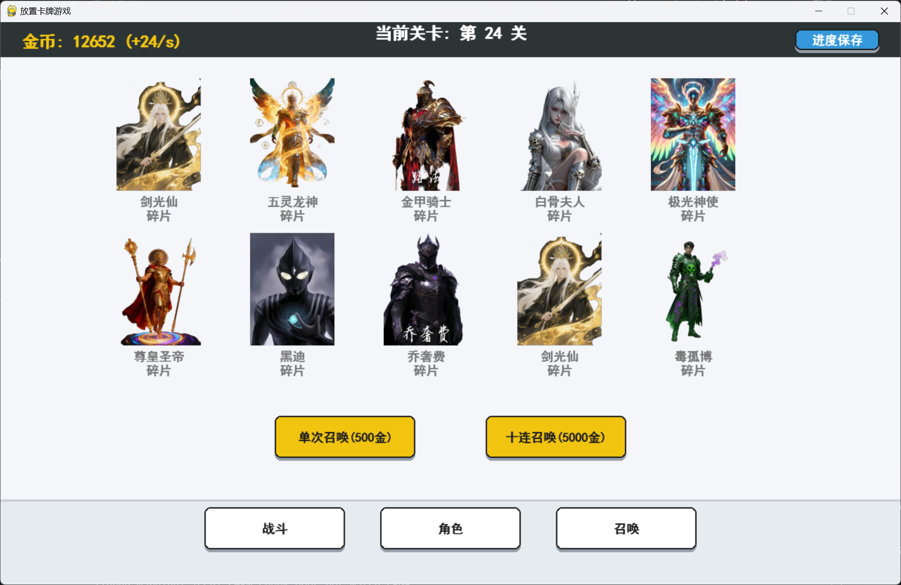
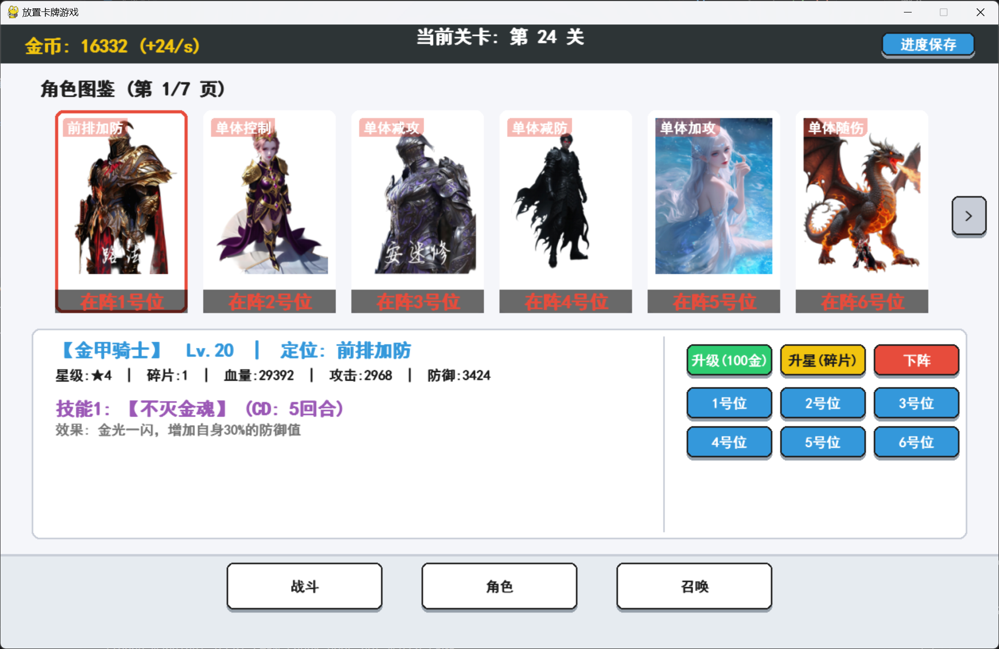
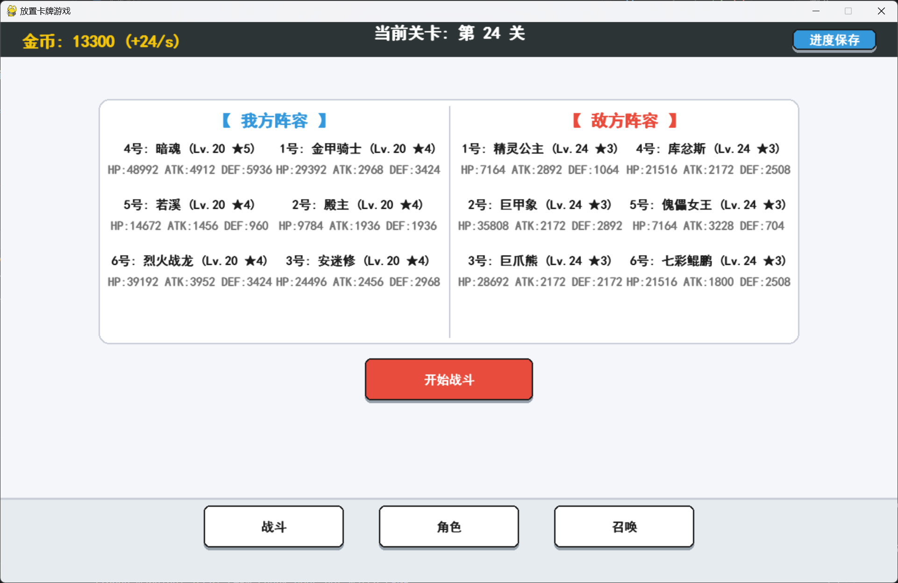
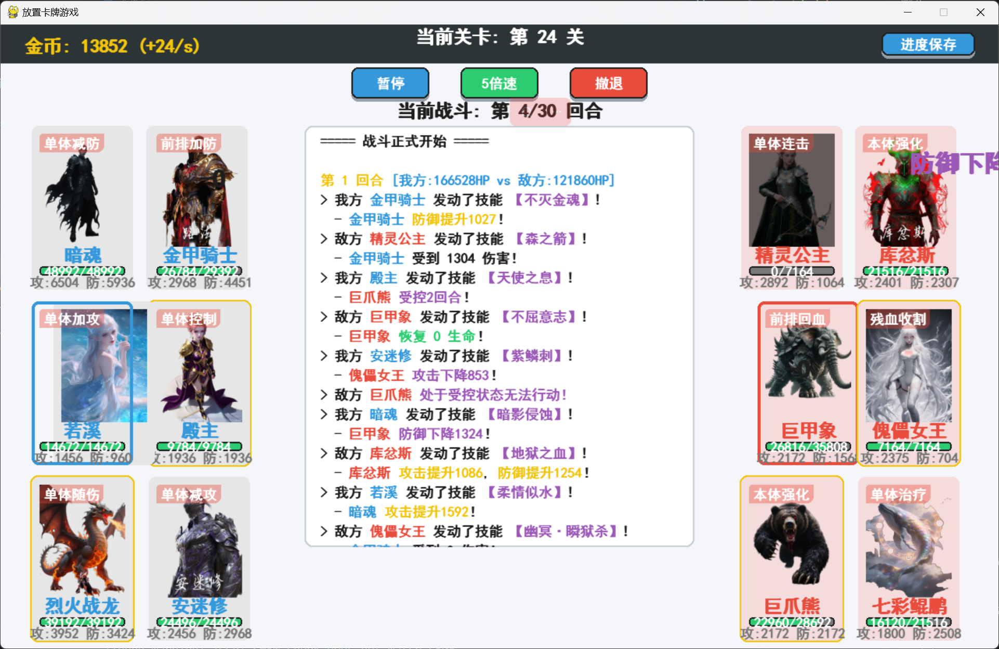
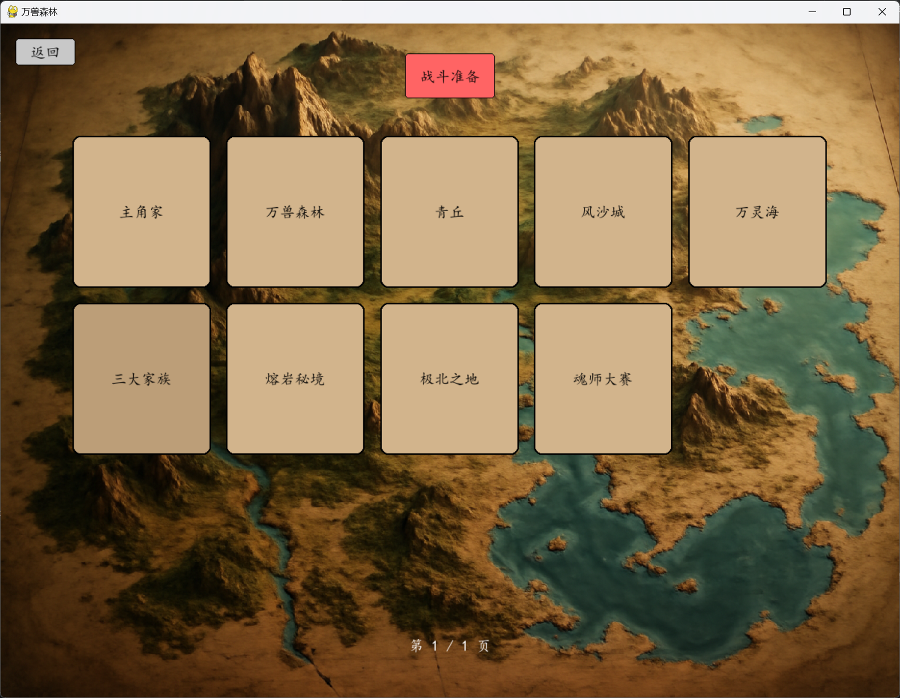
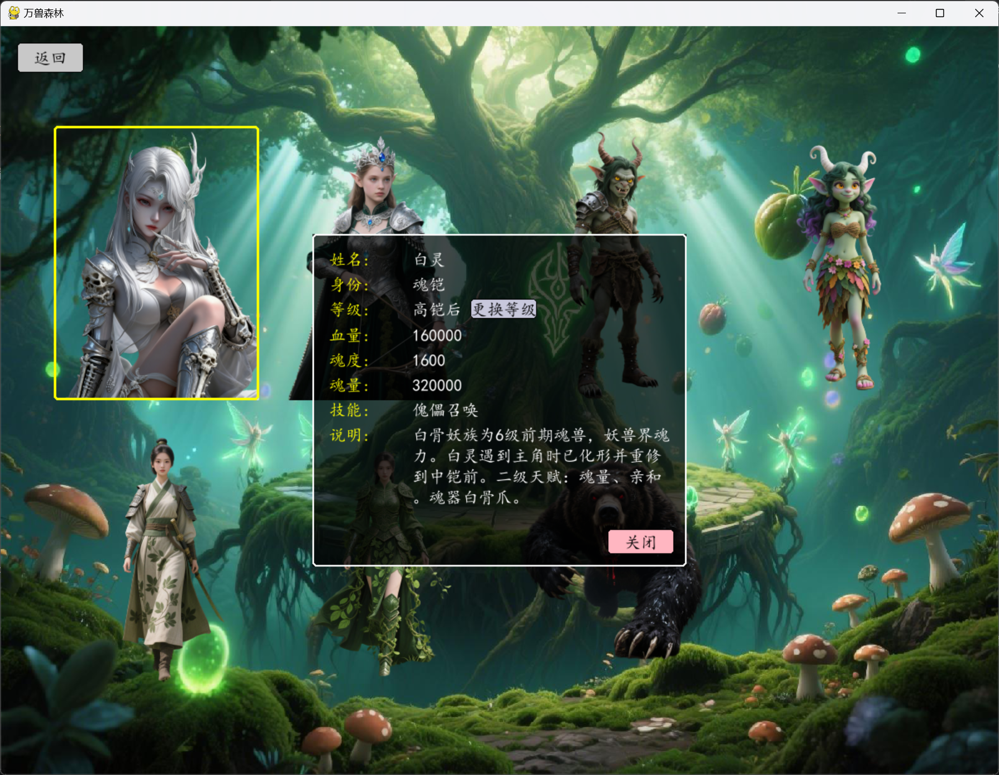
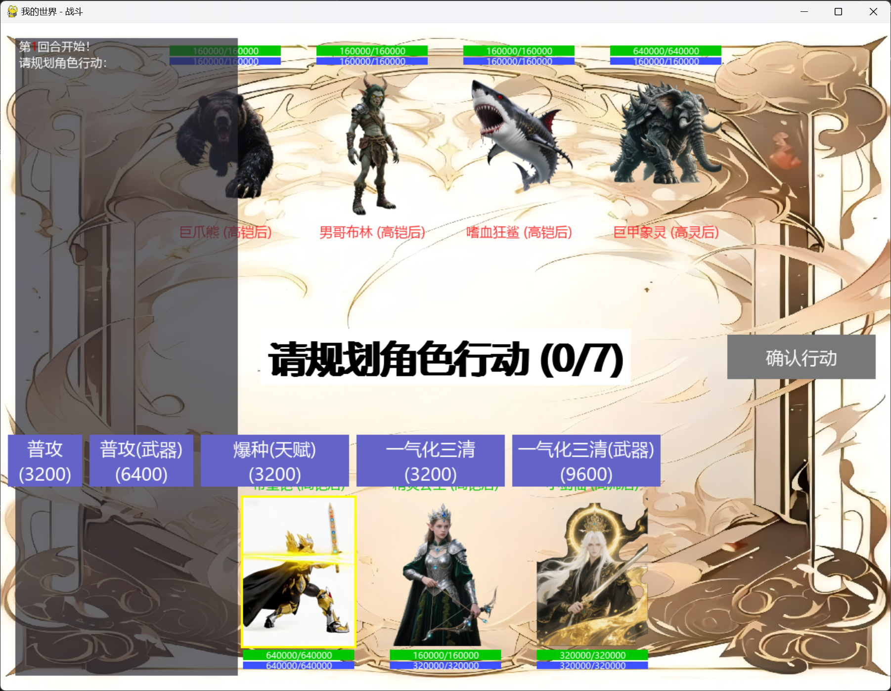

# CardPlacementGame

使用 Python 与 Pygame 开发的卡牌游戏，包含 **放置闯关** 与 **自由对战** 两种玩法。

| 想怎么玩 | 选择模式 | 核心流程 |
| --- | --- | --- |
| 召唤养成、搭配阵容、挑战关卡 | 放置模式 | 召唤 → 升级上阵 → 自动战斗 → 获取金币继续培养 |
| 浏览角色、自定义双方队伍、手动安排技能 | 自由模式 | 选择地图 → 组建双方队伍 → 逐回合规划行动 |

## 快速启动

安装 Python 后，在项目根目录 `Game` 打开终端，安装依赖：

```powershell
python -m pip install pygame opencv-python
```

选择一个模式启动：

```powershell
# 放置模式
python Code/Card_Place/main.py
```

```powershell
# 自由模式
python Code/Free/game_main.py
```

仅玩放置模式时安装 `pygame` 即可；自由模式还需要 `opencv-python` 用于视频播放。请保留完整项目及 `picture`、`effects` 等资源目录。使用 PyCharm 时，运行上述对应入口文件，将工作目录设为项目根目录。

## 一、放置模式：召唤、养成、上阵、闯关

**第一次玩：点击“召唤”获取角色 → 到“角色”页选择角色并点击阵位 → 切换“战斗”并点击“开始战斗”。** 至少上阵一名角色才能开战，最多上阵六名。

### 1. 召唤角色

点击底部 **召唤**，选择 **单次召唤（500 金）** 或 **十连召唤（5000 金）**。新角色可以到角色页培养；重复获得的角色会转化为该角色的碎片，用于升星。



*图中“碎片”表示本次抽到了已拥有的角色。*

### 2. 培养角色并安排阵位

点击底部 **角色**，再点击一张卡片，查看角色属性、定位和技能。通过左右箭头翻页寻找其他角色。

| 按钮 | 用途 |
| --- | --- |
| 升级（100 金） | 消耗金币提升选中角色的等级 |
| 升星（碎片） | 消耗该角色的碎片提升星级；所需数量等于当前星级 |
| 1 号位～6 号位 | 将选中角色安排到对应阵位 |
| 下阵 | 将选中角色从上阵队伍移除 |

先培养几名常用角色，结合技能说明搭配防御、输出、控制和辅助角色，再根据战斗表现调整队伍。



*先选角色，再点击右侧按钮；卡片底部会显示当前所在阵位。*

### 3. 查看阵容，开始挑战

点击底部 **战斗**，对比双方角色、等级、星级和属性。`HP` 是生命，`ATK` 是攻击，`DEF` 是防御。准备好后点击 **开始战斗**。



*可切回“角色”页调整阵容后再挑战。截图中的第 24 关是示例进度。*

### 4. 观看自动战斗

开战后角色自动行动和释放技能，无需逐个选择目标。中央日志记录伤害、治疗、控制与属性变化。

| 操作 | 用途 |
| --- | --- |
| 暂停 / 继续 | 暂停查看局势，再继续战斗 |
| 倍速 | 在 1、2、5 倍速之间切换 |
| 撤退 | 退出当前战斗，重新调整队伍 |
| 鼠标滚轮 | 滚动查看战斗或结算日志 |
| 返回关卡 | 结算后回到阵容页面 |



*卡关时先查看日志，判断输出或生存能力是否不足，再升级、升星或更换角色。*

### 5. 积累金币，保存进度

- 游戏运行时按秒增加金币，收益显示在左上角；关卡越高，每秒收益越高。
- 胜利获得金币并推进关卡，可继续召唤和培养角色。
- 退出前点击右上角 **进度保存**。存档位于 `Code/Card_Place/save_data.json`，下次启动自动读取。

## 二、自由模式：选择地图、组队、规划回合

**第一次玩：点击“进入世界” → 在地图点击“战斗准备” → 进入场景为双方添加角色 → 开始战斗 → 按提示规划行动。** 建议先各选一名角色，熟悉操作后再增加人数。

### 1. 选择地图，开启战斗准备

进入世界后，点击地点卡片浏览场景和角色；部分地点还有下级区域，可继续点击进入。左上角 **返回** 用于返回上一层。

要组队对战，先点击地图上方 **战斗准备**，再进入地点选择角色。



*地图既是角色浏览入口，也是组队入口。*

### 2. 查看角色并组建双方队伍

点击场景中的角色图片，查看身份、等级、血量、魂度、魂量和技能说明。点击 **更换等级** 可以选择该角色的等级。



*截图为角色浏览状态；在地图开启“战斗准备”后，角色详情才会出现组队按钮。*

1. 在角色详情点击 **加入我方** 或 **加入敌方**。
2. 继续挑选角色；已选角色可以通过 **移除队伍** 撤下。
3. 检查队伍列表，**双方各至少一名角色** 后点击 **开始战斗**。需要重选时可点击 **清空队伍**。

### 3. 逐个规划行动，再统一确认

按屏幕提示，为本回合可行动的角色安排动作：

1. **点击角色卡片**：选中后显示黄色边框和行动按钮。
2. **选择普攻或技能**：括号内数字为魂量消耗；鼠标悬停在技能按钮上可查看说明。
3. **点击目标**：根据中央提示选满目标数量，攻击与辅助技能的可选目标不同。
4. **为其余可行动角色安排动作**：直到中央规划进度达到要求。
5. 点击 **确认行动**，观看回合结算，再规划下一回合。



*“0/7”表示尚未完成本回合所需的 7 个角色行动规划，并非固定队伍人数。绿色条是生命，蓝色条是魂量。*

选错时，鼠标右键可取消当前正在选择的动作；点击已规划的角色可撤销其计划，再重新安排。左侧日志可查看实际战斗效果。

## 常见问题

| 问题 | 处理方式 |
| --- | --- |
| 提示找不到 `pygame` 或 `cv2` | 使用运行游戏的同一个 Python 安装依赖；`cv2` 对应安装包 `opencv-python` |
| 放置模式无法开战 | 到“角色”页选中角色并点击阵位，确保至少一名角色上阵 |
| 金币或碎片不足 | 积累运行中的金币收益、挑战关卡；召唤重复角色获取碎片 |
| 自由模式没有“加入我方 / 加入敌方” | 返回地图开启“战斗准备”，再进入场景点击角色 |
| 自由模式“开始战斗”不可用 | 确保我方和敌方都已加入角色 |
| 自由模式“确认行动”是灰色 | 完成所有可行动角色的计划，并选满技能要求的目标数量 |

## 开发说明

放置模式的环境配置、模块结构与角色、技能扩展说明见 [卡牌放置运行与开发教程](Code/Card_Place/README.md)。
